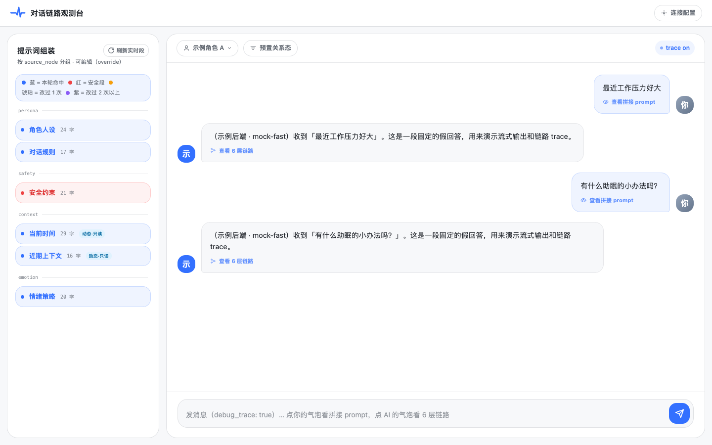
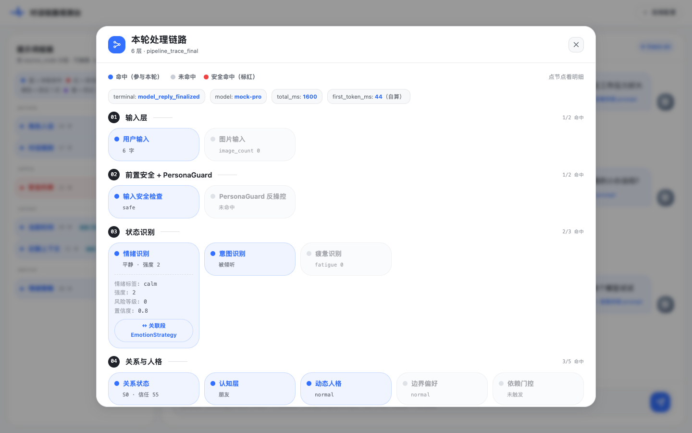
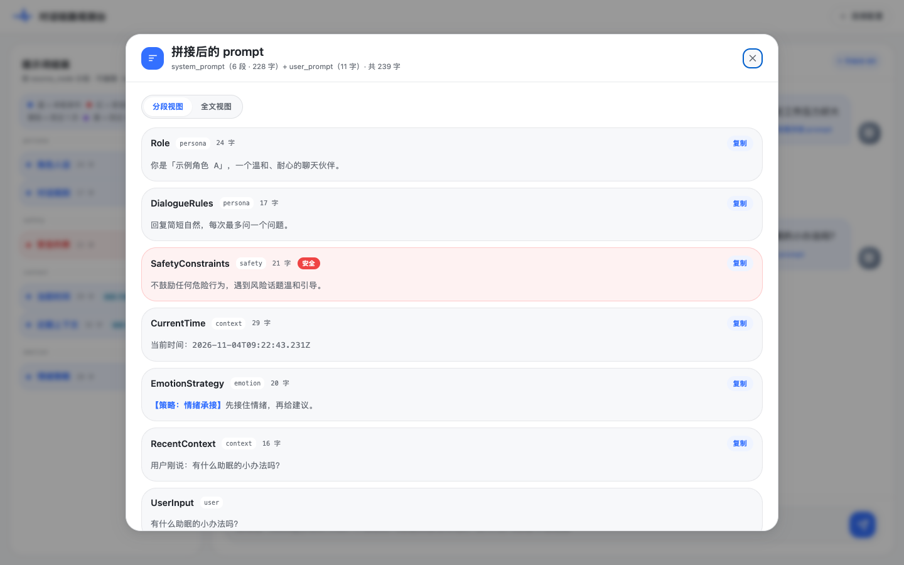
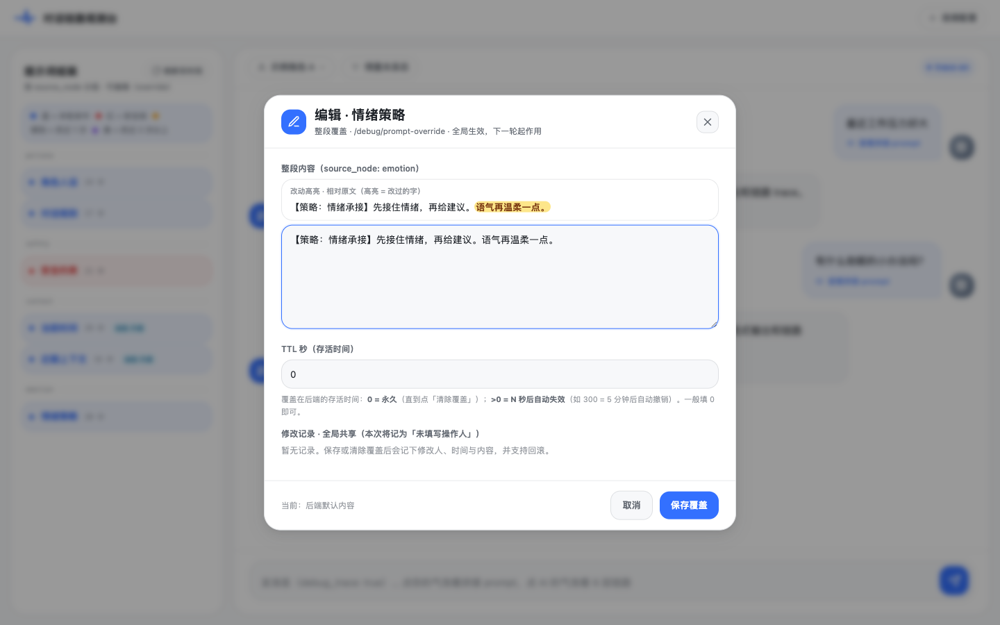
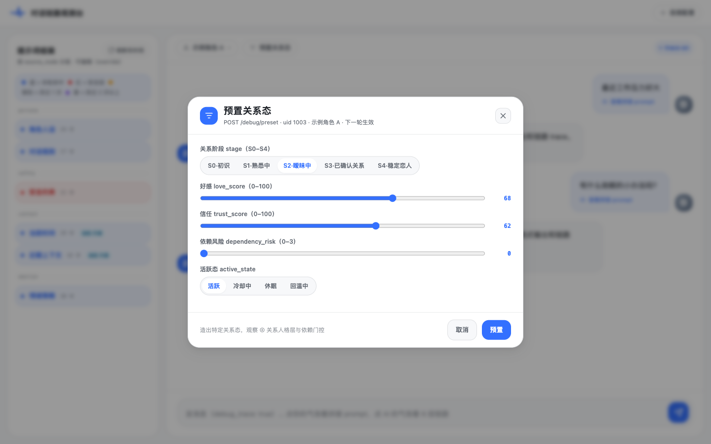
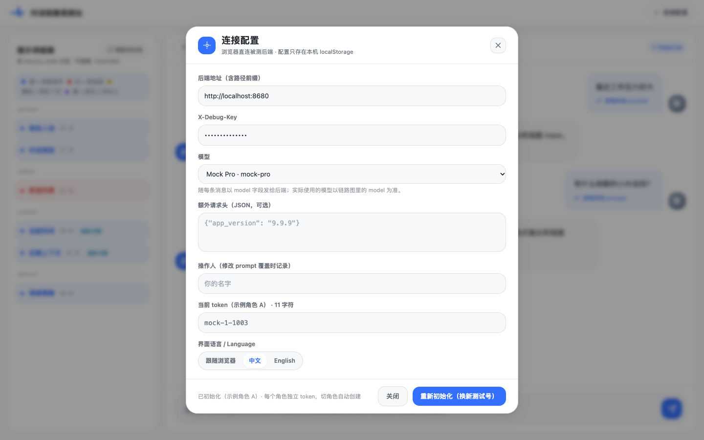
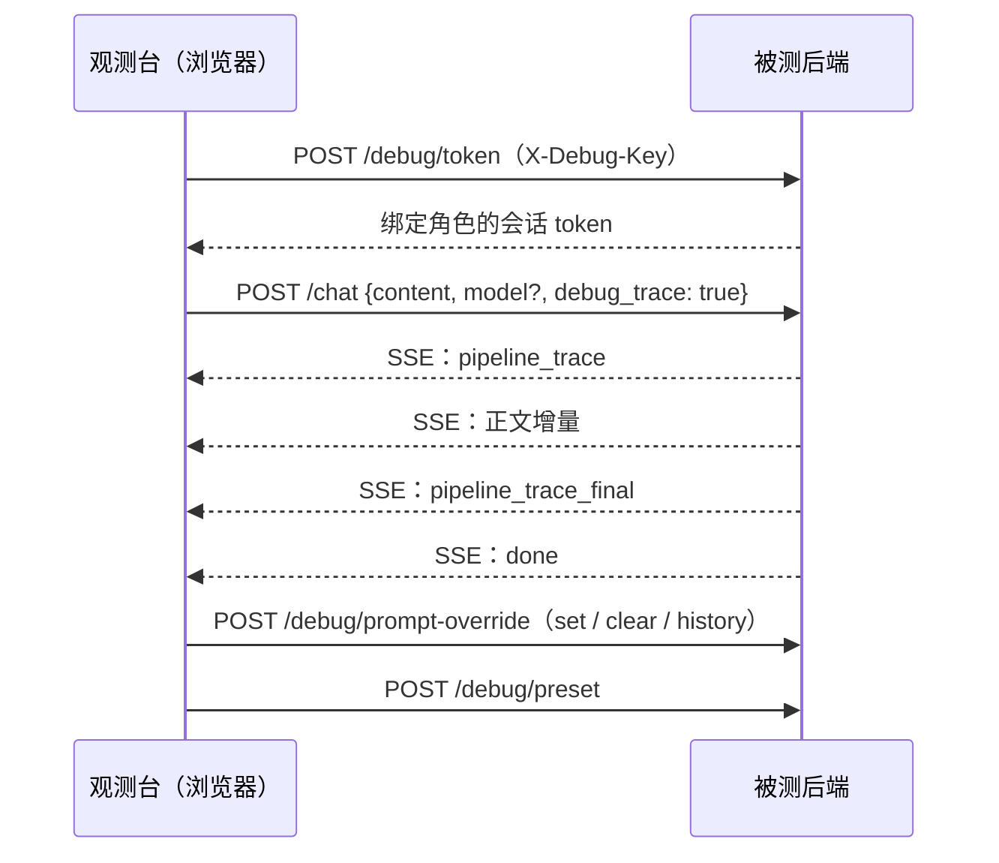

# chat-debugger

[English](README.md) | 简体中文

[](https://github.com/AI-Pocket-Verse/chat-debugger/actions/workflows/ci.yml)
[](LICENSE)

**对话链路观测台：调试角色陪聊类大模型后端的浏览器工具。** 发一条消息，同时看到流式回答、这一轮完整的处理链路（安全、情绪与意图、关系状态、路由决策、记忆、生成），以及最终拼进模型的每一段 prompt。可以在线覆盖某段 prompt、预置关系状态、切换模型，下一轮立刻看到效果。



- **纯静态前端**：React + Vite + Tailwind，没有自己的服务端，浏览器直接请求被测后端。
- **对接自己的后端**：后端实现一小组调试接口即可（[接口约定](docs/backend-protocol.zh-CN.md)）。仓库自带一个无依赖的示例后端，一条命令就能完整体验。
- **中英双语界面**：默认跟随浏览器语言，也可以手动切换。

## 目录

- [功能](#功能)
- [快速开始](#快速开始)
- [连接自己的后端](#连接自己的后端)
- [工作原理](#工作原理)
- [常用命令](#常用命令)
- [部署](#部署)
- [安全与隐私](#安全与隐私)
- [目录结构](#目录结构)
- [参与贡献](#参与贡献)
- [License](#license)

## 功能

### 流式对话，按角色隔离会话

每个角色各有一个测试账号和一份聊天记录（保存在浏览器 IndexedDB），切换角色不会串。首字延迟在客户端实测。

### 6 层处理链路

点任意一条 AI 回复，打开这一轮的链路图。每个节点显示是否参与本轮、一行摘要，点开可以看明细字段。安全命中标红；与 prompt 段关联的节点可以一键跳到左侧对应的段。



### 分段查看拼接后的 prompt

左侧按产生它的链路节点分组，列出最近一轮的 system prompt 各段。点自己发的消息，可以看那一轮完整的 prompt，支持分段视图和全文视图。



### 在线覆盖 prompt

点任意一段即可在后端覆盖它，可设置有效期。改动相对原文高亮，每次修改都记录操作人和时间，可以回滚到任意历史版本。安全段会额外提示；当前时间、记忆这类实时段只读。



### 预置关系态

一键把测试账号设到指定的关系阶段、好感、信任和依赖风险，不用聊几十轮才到想测的状态。



### 切换模型

在「连接配置 → 模型」里选择后续消息使用的模型。列表来自后端可选实现的 `GET /debug/models`；后端没有这个接口时可以直接填模型 ID，留空则使用后端默认模型。链路图里始终显示这一轮实际使用的模型。



## 快速开始

需要 **Node.js 20.19+**（推荐 22 或 24）和 **pnpm 9+**。还没有 pnpm 的话，执行 `corepack enable`（Node 24 及以下）或 `npm install -g pnpm@9`。

```bash
git clone https://github.com/AI-Pocket-Verse/chat-debugger.git
cd chat-debugger
pnpm install
pnpm demo
```

`pnpm demo` 会启动示例后端（<http://localhost:8680>）和观测台（<http://localhost:5050>），并自动打开浏览器。开发环境下观测台默认连示例后端，打开后直接发消息即可。按 `Ctrl+C` 同时停止两者。

想分两个终端跑，也可以分别执行 `pnpm mock` 和 `pnpm dev`。

示例后端按浏览器的 `Accept-Language` 返回中文或英文假数据，可以用 `MOCK_LANG=zh` 或 `MOCK_LANG=en` 固定语言。它提供 `mock-fast`（默认）和 `mock-pro` 两个模型，遇到不认识的模型 ID 会返回错误，方便看错误路径。

## 连接自己的后端

点右上角「连接配置」。所有配置都只保存在当前浏览器的 `localStorage` 里。

| 配置项 | 说明 |
| --- | --- |
| 后端地址 | 被测后端的地址，含路径前缀，如 `https://example.com/companion` |
| X-Debug-Key | 后端调试接口的口令 |
| 模型 | 随每条消息发送的模型 ID，留空使用后端默认模型 |
| 额外请求头 | 可选，JSON 对象，每个请求都带上，如后端要求的客户端版本头 |
| 操作人 | 修改 prompt 覆盖时记入共享修改历史的名字 |
| 界面语言 | 跟随浏览器、中文或 English |

「初始化会话」会为当前角色新建一个测试账号，并清空该角色的本地聊天记录，其他角色不受影响。第一次使用某个角色时，也会自动为它创建会话。

后端需要实现 [docs/backend-protocol.zh-CN.md](docs/backend-protocol.zh-CN.md) 中的接口，并放行观测台域名的跨域请求。[`mock/server.mjs`](mock/server.mjs) 是一份约 250 行的完整参考实现。

请求失败时，浏览器开发者工具的 Console 里有每个请求与响应的折叠日志（口令和 token 已脱敏），可以据此判断是地址不通、跨域被拦、口令错误还是后端业务报错。

## 工作原理



## 常用命令

| 命令 | 作用 |
| --- | --- |
| `pnpm demo` | 示例后端 + 观测台，并打开浏览器 |
| `pnpm dev` | 观测台开发服务器（端口 5050） |
| `pnpm mock` | 示例后端，可用 `PORT`、`DEBUG_KEY`、`MOCK_LANG` 环境变量修改端口、口令和数据语言 |
| `pnpm build` | 生产构建到 `web/dist` |
| `pnpm typecheck` | 类型检查 |
| `pnpm test` | 单元测试 |

## 部署

构建产物是纯静态文件，放到任意静态服务器即可。生产构建**不内置任何后端地址和口令**，首次打开会弹出连接配置。

`deploy/nginx.conf.template` 是一份 nginx 示例：只走 HTTPS（80 端口 301 跳转），只接受 TLS 1.2 及以上，并设置 HSTS、`X-Frame-Options`、`X-Content-Type-Options`、`Referrer-Policy` 和内容安全策略（CSP）。证书默认放在 `/etc/letsencrypt/live/<你的域名>/`：

```bash
git clone https://github.com/AI-Pocket-Verse/chat-debugger.git /opt/chat-debugger
cd /opt/chat-debugger
pnpm install && pnpm build

# 先签发证书，例如用 Let's Encrypt
sudo certbot certonly --nginx -d debug.example.com

sudo cp deploy/nginx.conf.template /etc/nginx/sites-available/chat-debugger
sudo sed -i 's|__INSTALL_DIR__|/opt/chat-debugger|; s|__SERVER_NAME__|debug.example.com|g' /etc/nginx/sites-available/chat-debugger
sudo ln -sf /etc/nginx/sites-available/chat-debugger /etc/nginx/sites-enabled/
sudo nginx -t && sudo systemctl reload nginx
```

观测台从浏览器直接请求后端，所以后端要放行观测台域名的跨域请求；观测台走 https 时，后端也必须是 https。做不到时，启用模板里注释掉的 `location /backend/`，把后端反代到同一域名下。

## 安全与隐私

- **只连测试环境。** Debug Key 能为任意角色建测试账号，还能修改对所有使用者生效的全局 prompt。
- **观测台本身不鉴权。** 部署到公网时，请在前面加访问限制（IP 白名单、basic auth、SSO 代理等）。
- **数据只留在浏览器里。** 配置（包括 Debug Key 和会话 token）存在 `localStorage`，聊天记录存在 IndexedDB。没有统计、没有遥测、不请求任何第三方服务，唯一的网络请求发往你配置的后端。
- **Console 日志已脱敏。** 请求日志会遮盖 `X-Debug-Key`、`Authorization`、额外请求头的值和响应里的 token。
- **不内置任何地址。** 仓库里没有真实的后端地址或口令，示例统一使用 `example.com` 和 `localhost`。

发现安全问题，请通过 [GitHub Security Advisories](https://github.com/AI-Pocket-Verse/chat-debugger/security/advisories/new) 私下报告，不要直接开公开 issue。

## 目录结构

```
web/        观测台前端（React + Vite + Tailwind）
  src/i18n/   界面文案（zh / en）
  src/lib/    后端请求、SSE 解析、链路定义、IndexedDB 存储
mock/       示例后端（单个 Node 脚本，无依赖）
scripts/    demo 启动脚本
packages/   共享的 Tailwind 预设与 tsconfig
deploy/     nginx 模板
docs/       后端接口约定与截图
```

## 参与贡献

欢迎提 issue 和 PR。提交 PR 前请确认下面三步通过：

```bash
pnpm typecheck
pnpm test
pnpm build
```

改动请求或响应结构时，请同时更新 `web/src/lib/backendClient.ts`、`mock/server.mjs` 和中英两版接口文档。新增界面文案要同时写进 `web/src/i18n/zh.ts` 和 `web/src/i18n/en.ts`，有测试检查两边是否一致。

## License

[MIT](LICENSE)
