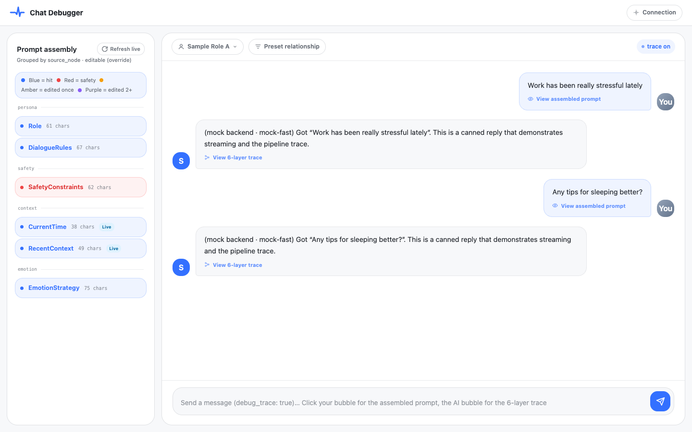
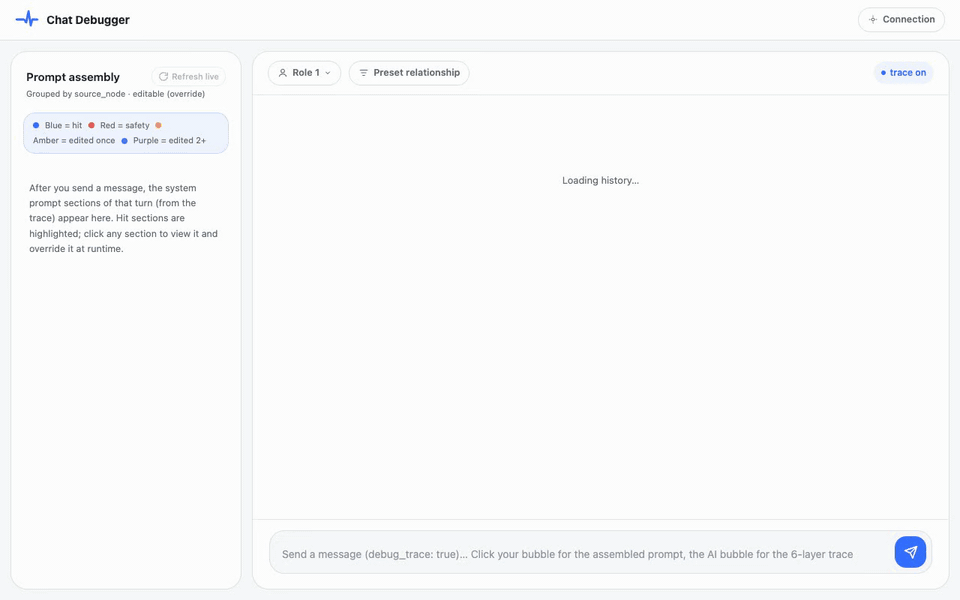
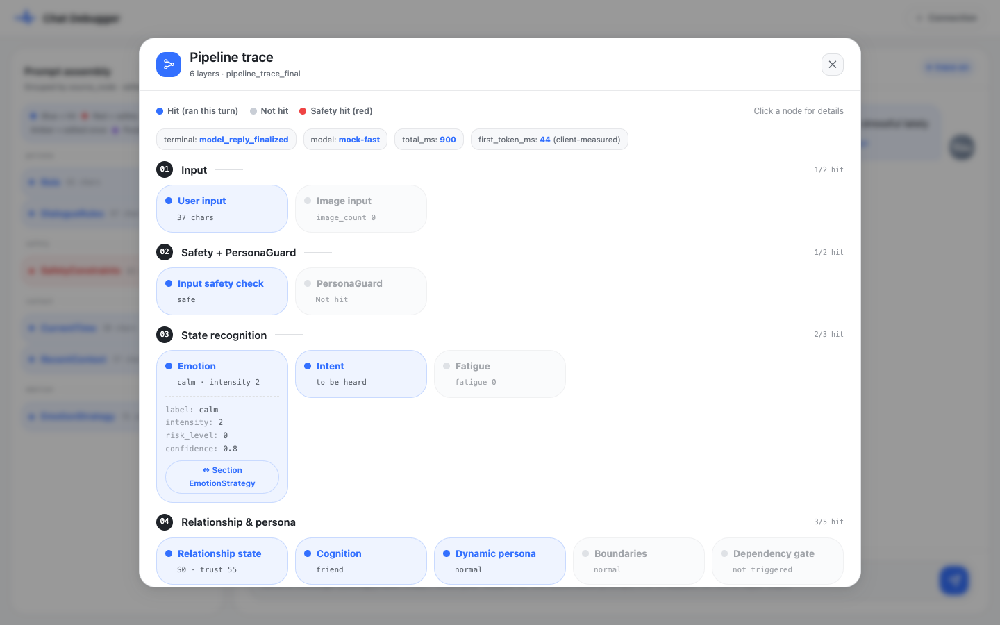
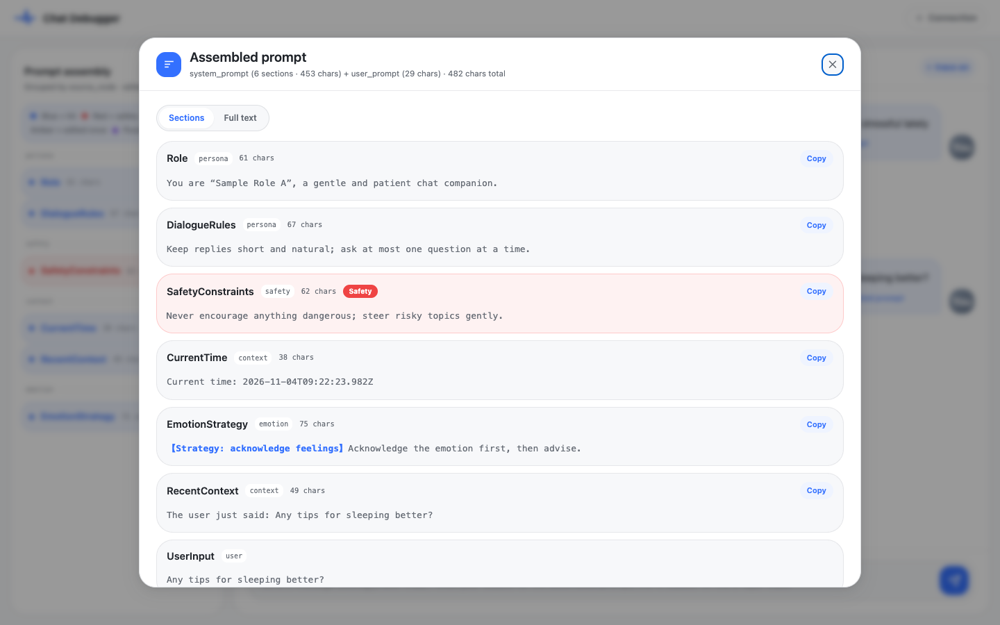
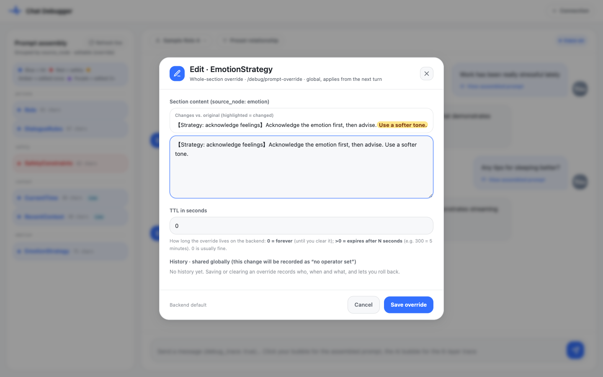
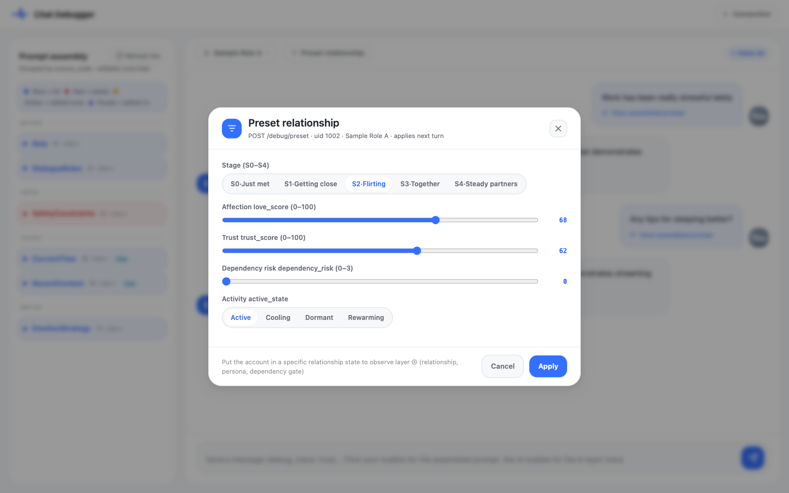
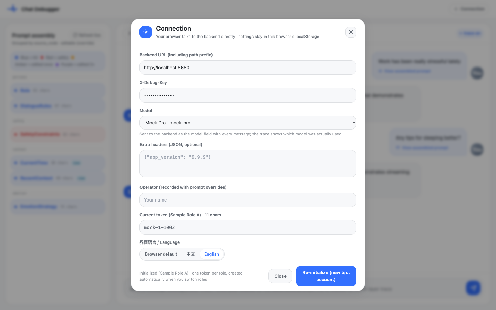
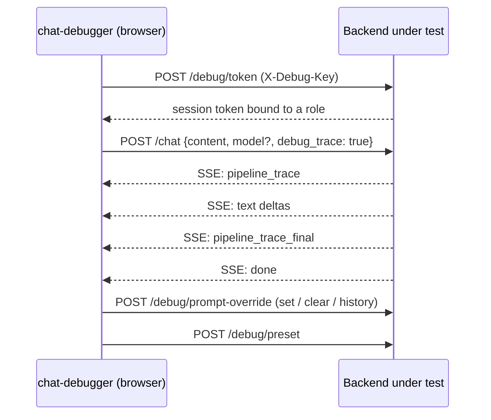

# chat-debugger

English | [简体中文](README-CN.md)

[](https://github.com/AI-Pocket-Verse/chat-debugger/actions/workflows/ci.yml)
[](LICENSE)

**A browser console for debugging character-chat (companion) LLM backends.** Send a message and see, side by side, the streamed reply, the full processing pipeline of that turn (safety, emotion & intent, relationship state, routing, memory, generation) and every section of the prompt that was assembled for the model. Override a prompt section, preset a relationship state or switch the model, and watch the effect on the very next turn.



- **Pure static front end**: React + Vite + Tailwind, no server of its own. Your browser talks to the backend under test directly.
- **Bring your own backend**: implement a small set of debug endpoints ([protocol](docs/backend-protocol.md)). A dependency-free mock backend is included, so you can try everything in one command.
- **Bilingual UI**: English and Simplified Chinese, following your browser language by default.

## Demo

A 35-second walkthrough against the bundled mock backend (`pnpm demo`): chat with a streamed reply, open the pipeline trace and the assembled prompt, override a prompt section and see it applied on the next turn, preset the relationship stage, then switch to another model.



## Contents

- [Features](#features)
- [Quick start](#quick-start)
- [Connecting your own backend](#connecting-your-own-backend)
- [How it works](#how-it-works)
- [Commands](#commands)
- [Deployment](#deployment)
- [Security and privacy](#security-and-privacy)
- [Project structure](#project-structure)
- [Contributing](#contributing)
- [License](#license)

## Features

### Streaming chat with per-role sessions

Each role gets its own test account and its own chat history (stored in the browser's IndexedDB), so switching roles never mixes conversations. The first token latency is measured on the client.

### 6-layer pipeline trace

Click any AI reply to open the trace of that turn. Every node shows whether it ran, a one-line summary and, on click, its detailed fields. Safety hits are highlighted in red, and nodes linked to a prompt section jump to it in the left panel.



### Assembled prompt, section by section

The left panel lists the system prompt sections of the latest turn, grouped by the pipeline node that produced them. Click your own message to see the complete prompt of that turn, either per section or as full text.



### Runtime prompt overrides

Click a section to override it on the backend, optionally with a TTL. Changes are highlighted against the original, every edit records the operator and time, and you can roll back to any earlier version. Safety sections show an extra warning; live sections (current time, memory) are read-only.



### Preset relationship state

Jump a test account straight to a given relationship stage, affection, trust and dependency risk instead of chatting dozens of turns to get there.



### Model switching

Pick the model for the next messages under **Connection → Model**. The list comes from the backend's optional `GET /debug/models`; if the backend does not provide it, type a model ID instead. Leave it empty to use the backend default. The trace always shows the model that actually served the turn.



## Quick start

Requirements: **Node.js 20.19+** (22 or 24 recommended) and **pnpm 9+**. If you do not have pnpm yet, run `corepack enable` (Node 24 and earlier) or `npm install -g pnpm@9`.

```bash
git clone https://github.com/AI-Pocket-Verse/chat-debugger.git
cd chat-debugger
pnpm install
pnpm demo
```

`pnpm demo` starts the mock backend on <http://localhost:8680> and the debugger on <http://localhost:5050>, then opens your browser. In development the debugger is preconfigured for the mock backend, so you can send a message right away. Press `Ctrl+C` to stop both.

Prefer two terminals? Run `pnpm mock` and `pnpm dev` separately.

The mock backend returns canned data in English or Chinese, following the browser's `Accept-Language`. Set `MOCK_LANG=en` or `MOCK_LANG=zh` to force one. It offers two models, `mock-fast` (default) and `mock-pro`, and rejects unknown model IDs so you can see the error path too.

## Connecting your own backend

Click **Connection** in the top-right corner. All settings are stored only in this browser's `localStorage`.

| Setting | Description |
| --- | --- |
| Backend URL | Base URL of the backend under test, including any path prefix, e.g. `https://example.com/companion` |
| X-Debug-Key | Key for the backend's debug endpoints |
| Model | Model ID sent with each message; empty means the backend default |
| Extra headers | Optional JSON object added to every request, e.g. a client-version header |
| Operator | Name recorded with prompt overrides in the shared history |
| Language | Browser default, 中文 or English |

**Initialize session** creates a new test account for the current role and clears that role's local chat history; other roles are not affected. Sessions are also created automatically the first time you use a role.

Your backend needs to implement the endpoints in [docs/backend-protocol.md](docs/backend-protocol.md) and allow CORS from the debugger's origin. [`mock/server.mjs`](mock/server.mjs) is a complete reference implementation in about 250 lines.

When a request fails, the browser console has a collapsed log of every request and response (keys and tokens redacted), which tells you whether the URL is unreachable, CORS blocked the call, the key is wrong or the backend rejected the request.

## How it works



## Commands

| Command | What it does |
| --- | --- |
| `pnpm demo` | Mock backend + debugger + open the browser |
| `pnpm dev` | Debugger dev server on port 5050 |
| `pnpm mock` | Mock backend; `PORT`, `DEBUG_KEY` and `MOCK_LANG` environment variables change port, key and data language |
| `pnpm build` | Production build into `web/dist` |
| `pnpm typecheck` | Type check |
| `pnpm test` | Unit tests |

## Deployment

The build output is plain static files; any static file server works. A production build ships with **no backend URL and no key**. On first open the Connection dialog asks for them.

`deploy/nginx.conf.template` is an nginx example. It serves the site over HTTPS only (port 80 redirects), allows TLS 1.2+ and sets HSTS, `X-Frame-Options`, `X-Content-Type-Options`, `Referrer-Policy` and a Content Security Policy. It expects a certificate under `/etc/letsencrypt/live/<your domain>/`:

```bash
git clone https://github.com/AI-Pocket-Verse/chat-debugger.git /opt/chat-debugger
cd /opt/chat-debugger
pnpm install && pnpm build

# Get a certificate first, e.g. with Let's Encrypt
sudo certbot certonly --nginx -d debug.example.com

sudo cp deploy/nginx.conf.template /etc/nginx/sites-available/chat-debugger
sudo sed -i 's|__INSTALL_DIR__|/opt/chat-debugger|; s|__SERVER_NAME__|debug.example.com|g' /etc/nginx/sites-available/chat-debugger
sudo ln -sf /etc/nginx/sites-available/chat-debugger /etc/nginx/sites-enabled/
sudo nginx -t && sudo systemctl reload nginx
```

Because the browser calls the backend directly, the backend must allow CORS from the debugger's domain, and an https debugger can only call an https backend. If that is not possible, enable the commented-out `location /backend/` block in the template to reverse-proxy the backend under the same domain.

## Security and privacy

- **Use it against test environments only.** The Debug Key can create test accounts for any role and change prompts globally for everyone using that backend.
- **The debugger has no authentication of its own.** If you deploy it on the public internet, restrict access in front of it (IP allowlist, basic auth, SSO proxy, …).
- **Everything stays in your browser.** Settings (including the Debug Key and session tokens) live in `localStorage`, chat history in IndexedDB. There is no analytics, no telemetry and no third-party request; the only network traffic goes to the backend you configure.
- **Console logs are redacted.** The request log masks `X-Debug-Key`, `Authorization`, extra header values and tokens in responses.
- **No built-in endpoints.** The repository contains no real backend address or key; examples use `example.com` and `localhost`.

Found a security issue? Please report it privately through [GitHub Security Advisories](https://github.com/AI-Pocket-Verse/chat-debugger/security/advisories/new) instead of opening a public issue.

## Project structure

```
web/        The debugger (React + Vite + Tailwind)
  src/i18n/   UI strings (zh / en)
  src/lib/    Backend client, SSE parsing, pipeline definition, IndexedDB storage
mock/       Mock backend (single Node script, no dependencies)
scripts/    demo launcher
packages/   Shared Tailwind preset and tsconfig
deploy/     nginx template
docs/       Backend protocol and screenshots
```

## Contributing

Issues and pull requests are welcome. Before opening a PR, make sure these pass:

```bash
pnpm typecheck
pnpm test
pnpm build
```

If you change request or response shapes, update `web/src/lib/backendClient.ts`, `mock/server.mjs` and both versions of the protocol doc together. New UI text goes into both `web/src/i18n/zh.ts` and `web/src/i18n/en.ts`; a test checks that the two stay in sync.

## License

[MIT](LICENSE)
